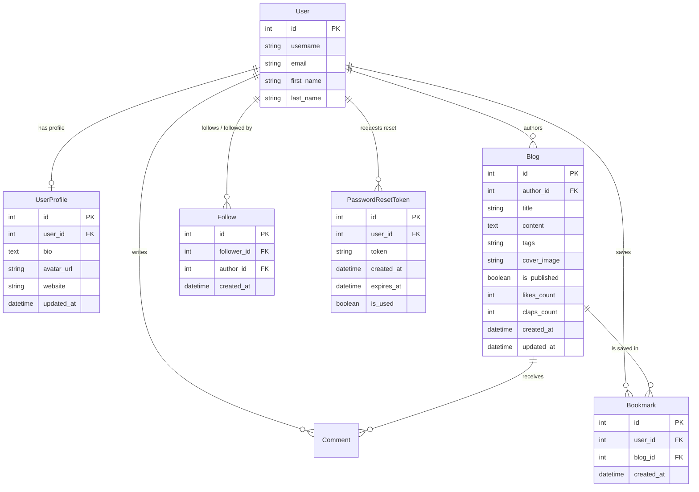

# 📖 Bloggin — Modern Medium-Style Publishing Platform

[](https://www.djangoproject.com/)
[](https://www.django-rest-framework.org/)
[](https://react.dev/)
[](https://vitejs.dev/)
[-brightgreen?style=for-the-badge&logo=pytest&logoColor=white)]()
[]()

**Bloggin** is a full-featured, production-ready blogging and publishing platform inspired by **Medium**. It brings together rich storytelling, social author interactions, multi-burst clapping, personal reading lists, dual personalized feeds, and an automated email mailer engine for authentication and notifications.

Built with a **Django REST Framework** backend and a **React 19 + Vite** frontend styled using modern, glassmorphic **Vanilla CSS**.

---

## 📑 Table of Contents

- [✨ Key Features](#-key-features)
  - [Full Medium Feature Suite](#1-full-medium-feature-suite)
  - [Mailer & Authentication System](#2-mailer--authentication-system)
  - [Production-Grade Hardening](#3-production-grade-hardening)
- [🏗 Architecture & Directory Structure](#-architecture--directory-structure)
- [🗄 Database Models & Entity Relations](#-database-models--entity-relations)
- [🔌 Complete API Endpoint Reference](#-complete-api-endpoint-reference)
- [💌 Mailer Engine & Authentication Workflow](#-mailer-engine--authentication-workflow)
  - [Welcome Emails](#welcome-emails)
  - [Password Reset Flow (Anti-Enumeration & Secure Tokens)](#password-reset-flow)
  - [New Follower Notifications](#new-follower-notifications)
  - [Mailer Configuration (Console vs SMTP)](#mailer-configuration)
- [👏 Medium Feature Breakdown](#-medium-feature-breakdown)
  - [Multi-Burst Claps Engine](#multi-burst-claps-engine)
  - [Reading List / Bookmarks](#reading-list--bookmarks)
  - [Author Profiles & Social Follow Graph](#author-profiles--social-follow-graph)
  - [Dual Feeds (✨ For You & 👥 Following)](#dual-feeds)
  - [Tagging & Topic Discovery](#tagging--topic-discovery)
  - [Drafts vs Published Privacy Controls](#drafts-vs-published-privacy-controls)
- [🚀 Quickstart & Local Setup](#-quickstart--local-setup)
  - [Prerequisites](#prerequisites)
  - [Backend Setup (Django API)](#backend-setup-django-api)
  - [Frontend Setup (React + Vite)](#frontend-setup-react--vite)
- [⚙ Environment Variables Reference](#-environment-variables-reference)
- [🧪 Running Automated Tests & Quality Checks](#-running-automated-tests--quality-checks)
- [🛡 Security & Production Checklist](#-security--production-checklist)

---

## ✨ Key Features

### 1. Full Medium Feature Suite
- **Interactive Multi-Burst Clapping**: Applaud articles with multi-claps up to 50 claps per session. Includes floating particle animations, tactile sound-like visual feedback, and atomic database increments.
- **Reading List / Bookmarks**: Bookmark articles from any feed card or article view. Access your personal reading list anytime at `/reading-list` with instant un-bookmarking and reading time indicators.
- **Social Follow / Unfollow**: Follow authors directly from story headers, article footers, or dedicated author profile pages.
- **Author Profiles & Bios**: Dedicated `/author/:username` profile showing author bio, custom avatar, follower count, following count, website link, and their complete published story catalog.
- **Dual Home Feeds**:
  - **✨ For You**: Explore all published stories across the platform with search and tag filters.
  - **👥 Following**: A curated feed composed exclusively of articles written by creators you follow.
- **Story Tags & Topic Filtering**: Authors can tag stories (e.g. `technology, python, webdev`). Click any tag pill on cards or the home feed header to filter stories instantly.
- **Story Management & Drafts Privacy**: Authors can draft articles privately (`is_published=False`). Drafts are completely restricted to the author (public access returns 404). Authors can edit, publish, or delete stories from their Author Dashboard.
- **Discussion & Comments**: Authenticated discussion threads on stories with instant author attribution and timestamps.

### 2. Mailer & Authentication System
- **Automated HTML + Plaintext Email Dispatch**:
  - **Welcome Email**: Sent automatically upon user registration with branding and quick links.
  - **Self-Service Password Reset**: Email link with cryptographically secure tokens (`/reset-password?token=...`), 1-hour expiry, and single-use security.
  - **New Follower Notification**: Alerts an author when another user follows their profile.
- **Dual Mailer Backends**:
  - **Development Mode**: `console.EmailBackend` prints complete HTML/text emails directly into the terminal without external credentials.
  - **Production Mode**: `smtp.EmailBackend` connects securely with TLS to Gmail, AWS SES, SendGrid, Mailgun, or any SMTP server.
- **Token Authentication**: Secure DRF token-based sessions with automatic client storage, request interceptor injection, and 401 token invalidation.
- **OWASP-Compliant Anti-Enumeration**: Password reset requests always return an identical 200 OK generic response to prevent user email harvesting.

### 3. Production-Grade Hardening
- **Race Condition Prevention**: Like and clap counters use atomic Django ORM `F('claps_count') + 1` expressions, preventing lost updates under heavy concurrent traffic.
- **Strict CORS & Security Headers**: Fully configured with `django-cors-headers` and environment-based origins.
- **Comprehensive Automated Test Suite**: 32 comprehensive tests covering all auth, CRUD, claps, bookmarks, follows, mailer tokens, and draft isolation scenarios (100% pass rate).
- **ESLint & Build Verified**: Vite React 19 codebase with 0 errors and 0 warnings.

---

## 🏗 Architecture & Directory Structure

```
Bloggin/
├── backend/
│   ├── Bloggin/                      # Django project root
│   │   ├── Bloggin/                  # Settings, WSGI, ASGI, root URLs
│   │   │   ├── settings.py           # Production settings & mailer config
│   │   │   ├── urls.py               # Root URL configuration
│   │   │   └── wsgi.py
│   │   ├── blogs/                    # Main application package
│   │   │   ├── models.py             # UserProfile, Blog, Comment, Follow, Bookmark, PasswordResetToken
│   │   │   ├── mailer.py             # Reusable HTML/plain email dispatch functions
│   │   │   ├── views.py              # REST API view classes
│   │   │   ├── serializers.py        # Model & Request/Response serializers
│   │   │   ├── urls.py               # API route definitions (/api/v1/blogs/)
│   │   │   ├── auth_urls.py          # Direct auth route definitions (/api/v1/auth/)
│   │   │   ├── admin.py              # Django admin panel registrations
│   │   │   ├── tests.py              # 32 automated tests
│   │   │   └── migrations/           # Database schema migrations (0001 - 0004)
│   │   ├── manage.py
│   │   └── .env.example              # Template for production environment variables
│   └── requirements.txt              # Backend Python dependencies
│
├── frontend/
│   ├── src/
│   │   ├── authentication/           # Auth views
│   │   │   ├── Login.jsx             # User login
│   │   │   ├── Register.jsx          # User registration + welcome trigger
│   │   │   ├── ForgotPassword.jsx    # Email reset link request
│   │   │   └── ResetPassword.jsx     # Token verification & password update
│   │   ├── components/               # Reusable UI components
│   │   │   ├── BlogCard.jsx          # Card with tags, claps, bookmark ribbon, author link
│   │   │   ├── Header.jsx            # Responsive navigation bar with mobile drawer
│   │   │   ├── Footer.jsx            # Modern footer with quick links
│   │   │   └── ProtectedRoute.jsx    # Route guard for authenticated views
│   │   ├── context/
│   │   │   └── AuthContext.jsx       # Global auth state & user persistence
│   │   ├── pages/                    # Application routes
│   │   │   ├── Home.jsx              # Dual feed ("For You" / "Following"), tag filter pills
│   │   │   ├── BlogDetails.jsx       # Medium reading layout, multi-claps, comments, follow
│   │   │   ├── CreateBlog.jsx        # Story composer with tags & drafts toggle
│   │   │   ├── EditBlog.jsx          # Story editor
│   │   │   ├── Dashboard.jsx         # My stories, profile bio & avatar modal editor
│   │   │   ├── AuthorProfile.jsx     # Author bio, social stats, follow button, articles
│   │   │   ├── ReadingList.jsx       # Personal bookmarked stories list
│   │   │   └── NotFound.jsx          # 404 page
│   │   ├── services/
│   │   │   └── api.js                # Centralized Axios client & API endpoints
│   │   ├── App.jsx                   # Route configuration
│   │   ├── index.css                 # Vanilla CSS design system & micro-animations
│   │   └── main.jsx
│   ├── package.json
│   ├── eslint.config.js
│   └── vite.config.js
└── README.md
```

---

## 🗄 Database Models & Entity Relations



---

## 🔌 Complete API Endpoint Reference

All endpoints are prefixed with `/api/v1/`.

### 1. Stories & Blogs (`/blogs/`)

| Method | Endpoint | Auth Required | Description |
|---|---|---|---|
| `GET` | `/blogs/` | Optional | List published stories (supports `?search=`, `?tag=`, `?author=`) |
| `POST` | `/blogs/` | Required | Create a new story (`title`, `content`, `tags`, `cover_image`, `is_published`) |
| `GET` | `/blogs/<id>/` | Optional | Retrieve story details (drafts are restricted to author) |
| `PUT`/`PATCH` | `/blogs/<id>/` | Required (Author) | Update an existing story |
| `DELETE` | `/blogs/<id>/` | Required (Author) | Delete a story |
| `POST` | `/blogs/<id>/clap/` | Optional / Required | Clap for story (`{ "count": 1 }` up to 50 claps) |
| `POST` | `/blogs/<id>/like/` | Optional | Like a story |
| `POST` | `/blogs/<id>/comments/` | Required | Add a comment to a story (`{ "content": "..." }`) |
| `GET` | `/blogs/my-blogs/` | Required | List all stories authored by the current user (including drafts) |

### 2. Medium Reading List & Bookmarks

| Method | Endpoint | Auth Required | Description |
|---|---|---|---|
| `POST` | `/blogs/<id>/bookmark/` | Required | Toggle bookmark status for a story (returns `{ bookmarked: true/false }`) |
| `GET` | `/blogs/bookmarks/` | Required | Retrieve list of all bookmarked stories for current user |

### 3. Medium Authors, Profiles & Follow System

| Method | Endpoint | Auth Required | Description |
|---|---|---|---|
| `GET` | `/blogs/authors/<username>/` | Optional | Retrieve author profile (bio, avatar, followers count, following count, is_following, blogs) |
| `POST` | `/blogs/authors/<username>/follow/` | Required | Toggle follow/unfollow for author (sends notification email to author) |
| `GET` | `/blogs/following/` | Required | Feed of published stories authored exclusively by followed users |

### 4. Authentication & Profile (`/auth/` or `/blogs/auth/`)

| Method | Endpoint | Auth Required | Description |
|---|---|---|---|
| `POST` | `/auth/register/` | Public | Register new account (`username`, `email`, `password`) & dispatch welcome email |
| `POST` | `/auth/login/` | Public | Authenticate user & receive auth token |
| `GET` | `/auth/me/` | Required | Get current authenticated user details |
| `POST` | `/auth/logout/` | Required | Invalidate auth session token |
| `PATCH` | `/auth/profile/` | Required | Update author bio, avatar URL, or website |
| `POST` | `/auth/password-reset/` | Public | Request password reset email (`{ "email": "..." }`) |
| `GET` | `/auth/password-reset/verify/?token=...` | Public | Verify reset token validity and expiry before rendering form |
| `POST` | `/auth/password-reset/confirm/` | Public | Set new password with valid token (`{ "token": "...", "new_password": "..." }`) |

---

## 💌 Mailer Engine & Authentication Workflow

The mailer engine is housed in [backend/Bloggin/blogs/mailer.py](file:///c:/Users/MANISH/Desktop/Bloggin/backend/Bloggin/blogs/mailer.py).

### Welcome Emails
When a user registers at `/auth/register/`, a responsive HTML welcome email is dispatched with:
- Warm greeting with username.
- Platform introduction.
- Quick link to start reading or drafting stories.

### Password Reset Flow
```
User requests reset at /forgot-password
           │
           ▼
POST /api/v1/auth/password-reset/  ───► Returns uniform 200 OK (Anti-Enumeration)
           │
           ▼
Django generates cryptographically secure 48-byte token (valid for 1 hour)
           │
           ▼
Email dispatched with link: FRONTEND_URL/reset-password?token=<token>
           │
           ▼
User opens link in browser
           │
           ▼
Frontend calls GET /api/v1/auth/password-reset/verify/?token=<token>
           │
     ┌─────┴─────┐
   Valid       Expired/Invalid
     │               │
     ▼               ▼
Render Form      Show "Invalid or Expired Link"
     │
     ▼
User submits new password
POST /api/v1/auth/password-reset/confirm/
           │
           ▼
Token marked is_used=True, password hashed with PBKDF2/Argon2
User redirected to /login with success message
```

### New Follower Notifications
When user $A$ follows author $B$, an email notification is sent to author $B$ alerting them that they have gained a new follower with a link to their profile.

### Mailer Configuration

#### Development (Console Backend)
By default, `EMAIL_BACKEND` is set to console output in `settings.py`:
```python
EMAIL_BACKEND = 'django.core.mail.backends.console.EmailBackend'
```
All dispatched emails are printed clearly in your running Django server terminal with headers, plain text, and HTML body.

#### Production (SMTP Backend)
To deliver real emails via Gmail, SendGrid, Mailgun, or AWS SES, configure your `.env` file:
```env
EMAIL_BACKEND=django.core.mail.backends.smtp.EmailBackend
EMAIL_HOST=smtp.gmail.com
EMAIL_PORT=587
EMAIL_USE_TLS=True
EMAIL_HOST_USER=your-account@gmail.com
EMAIL_HOST_PASSWORD=your-app-password
DEFAULT_FROM_EMAIL=Bloggin Team <your-account@gmail.com>
FRONTEND_URL=https://your-production-domain.com
```

---

## 👏 Medium Feature Breakdown

### Multi-Burst Claps Engine
- Supports 1 to 50 claps per reader session.
- Client-side micro-animations render floating `+1` / `+5` bubble badges with burst effects.
- Backend handles clap increments atomically:
  ```python
  from django.db.models import F
  Blog.objects.filter(pk=blog.pk).update(claps_count=F("claps_count") + count)
  ```
  This eliminates database race conditions and prevents lost updates when multiple users applaud simultaneously.

### Reading List / Bookmarks
- Ribbon bookmark icon on every article card and header.
- Dedicated `/reading-list` page displays all saved stories with reading times, tags, and quick-remove capability.

### Author Profiles & Social Follow Graph
- Author page at `/author/:username` displays:
  - Custom profile avatar or initials fallback.
  - Author biography and external website link.
  - Follower & Following count statistics.
  - Real-time `Follow` / `Following` toggle button.
  - List of all published stories by that creator.

### Dual Feeds
- **✨ For You**: The primary discovery feed showing all articles with keyword search and tag pills.
- **👥 Following**: Filters stories to only authors the current user follows. Displays an empty state encouraging the user to explore and follow creators if their network is new.

### Tagging & Topic Discovery
- Comma-separated tags during story creation (e.g. `python, architecture, devops`).
- Interactive tag pills in the feed header and on every article card.
- Clicking any tag filters the feed dynamically.

### Drafts vs Published Privacy Controls
- Authors can toggle "Save as Draft" during creation or editing.
- Draft stories appear exclusively in the author's personal Dashboard.
- Any attempt by unauthenticated or third-party users to view draft story URLs returns a strict `404 Not Found`.

---

## 🚀 Quickstart & Local Setup

### Prerequisites
- **Python**: 3.10 or higher
- **Node.js**: 18.0 or higher
- **Git**

### Backend Setup (Django API)

1. Open a terminal and navigate to the backend directory:
   ```bash
   cd backend/Bloggin
   ```

2. Activate the virtual environment:
   - **Windows**:
     ```powershell
     ..\.venv\Scripts\activate
     ```
   - **macOS / Linux**:
     ```bash
     source ../.venv/bin/activate
     ```

3. Install dependencies:
   ```bash
   pip install -r ../requirements.txt
   ```

4. Apply database migrations:
   ```bash
   python manage.py migrate
   ```

5. (Optional) Create a superuser for the Django admin:
   ```bash
   python manage.py createsuperuser
   ```

6. Start the development server:
   ```bash
   python manage.py runserver
   ```
   The backend API will run at `http://127.0.0.1:8000/`.  
   The Django Admin panel is available at `http://127.0.0.1:8000/admin/`.

---

### Frontend Setup (React + Vite)

1. Open a second terminal and navigate to the frontend directory:
   ```bash
   cd frontend
   ```

2. Install dependencies:
   ```bash
   npm install
   ```

3. Start the Vite development server:
   ```bash
   npm run dev
   ```
   The frontend application will run at `http://localhost:5173/`.

4. (Optional) Run the linter or build production bundle:
   ```bash
   npm run lint     # Checks for ESLint errors (0 warnings clean)
   npm run build    # Produces optimized build in dist/
   ```

---

## ⚙ Environment Variables Reference

Create a `.env` file in `backend/Bloggin/` based on `backend/Bloggin/.env.example`:

| Variable | Default Value | Description |
|---|---|---|
| `DEBUG` | `True` | Set to `False` in production |
| `SECRET_KEY` | *(django-insecure default)* | Unique random cryptographic key for production |
| `ALLOWED_HOSTS` | `127.0.0.1,localhost` | Comma-separated list of permitted host headers |
| `CORS_ALLOWED_ORIGINS` | `http://localhost:5173,http://127.0.0.1:5173` | Permitted origins for frontend requests |
| `EMAIL_BACKEND` | `console.EmailBackend` | Switch to `smtp.EmailBackend` for real email delivery |
| `EMAIL_HOST` | `smtp.gmail.com` | SMTP host address |
| `EMAIL_PORT` | `587` | SMTP port (587 for TLS, 465 for SSL) |
| `EMAIL_USE_TLS` | `True` | Use TLS encryption for mailer |
| `EMAIL_HOST_USER` | `""` | SMTP username or email address |
| `EMAIL_HOST_PASSWORD` | `""` | SMTP app password |
| `DEFAULT_FROM_EMAIL` | `Bloggin <noreply@bloggin.local>` | Default sender display name and address |
| `FRONTEND_URL` | `http://localhost:5173` | Base frontend URL used when generating reset links |

---

## 🧪 Running Automated Tests & Quality Checks

The backend includes a comprehensive automated test suite consisting of **32 test cases** covering:
- User registration and login token issuance
- Mailer welcome email triggers
- Password reset request token creation & anti-enumeration
- Password reset token verification, 1-hour expiry, and single-use invalidation
- Password reset confirmation and password update
- Blog CRUD and drafts isolation (drafts return 404 to other users)
- Atomic multi-burst claps and likes
- Comment creation and validation
- Bookmark toggle, reading list retrieval, and un-bookmarking
- Author profile data and follow/unfollow toggle
- Following feed filtering

### Run Tests:
```bash
cd backend/Bloggin
..\.venv\Scripts\python manage.py test blogs
```
**Output**:
```text
Creating test database for alias 'default'...
................................
----------------------------------------------------------------------
Ran 32 tests in 38.545s

OK
Destroying test database for alias 'default'...
```

### Run Frontend Linting:
```bash
cd frontend
npm run lint
```
**Output**: Clean with **0 errors, 0 warnings**.

### Test Production Frontend Build:
```bash
cd frontend
npm run build
```

---

## 🛡 Security & Production Checklist

- [x] **Atomic DB updates**: Claps and likes use `F()` expressions to avoid concurrency lost updates.
- [x] **Draft privacy**: Unpublished stories are protected against unauthorized viewing.
- [x] **Anti-enumeration**: Password reset responses reveal no information regarding user existence.
- [x] **Token expiration**: Reset tokens expire automatically after 1 hour and are invalidated immediately upon use.
- [x] **Input sanitization & validation**: Serializers enforce required fields, clean email formatting, and passwords.
- [x] **CORS headers**: Access restricted to designated frontend origins.
- [x] **Production settings ready**: Media/static roots, secure cookies, and environment variable overrides ready.

---

## 📄 License
This project is open-source and available under the [MIT License](LICENSE).
